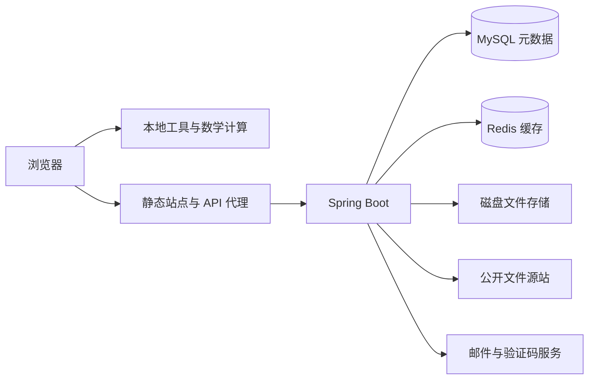

# KSCN · 知识共享协作网络

<div align="center">


**Knowledge Sharing Collaboration Network**

一个以公共资源共享、个人云盘和在线学习工具为核心的开源平台


[](https://vuejs.org/)
[](https://spring.io/projects/spring-boot)


[在线演示](https://kscn.top) · [问题反馈](https://github.com/fireLhq/kscn/issues) · [Telegram 群](https://t.me/kscn_top)

</div>

---

## 📖 项目简介

KSCN（Knowledge Sharing Collaboration Network，知识共享协作网络）希望为学习资料的汇集、整理和传播提供一个开放的线上空间。

你可以在公共资源库中获取与分享资料，在个人云盘中管理自己的文件，也可以使用浏览器中的文档、图片、Hash 去重、算法演示和数学工具处理内容、辅助学习。平台同时提供账号管理、系统消息、操作日志和管理后台，便于独立部署和日常维护。

项目采用 **Spring Boot + Vue 的前后端分离架构**：数据库保存文件元数据和业务记录，磁盘保存文件内容，部分在线工具直接在浏览器本地运行。

### ✨ 核心特性

- 🗂️ **公共资源库**：多级目录、搜索排序、网格与列表视图、上传下载和批量整理。
- ☁️ **个人云盘**：用户空间隔离，默认容量 10 GiB，支持分片上传、秒传和容量管理。
- 🔗 **网络文件**：公开直链导入为本地文件，或仅保存远程链接，按需访问源站。
- 📄 **文件预览**：图片、音视频、PDF、Office 文档、Markdown 和文本代码预览。
- ♻️ **文件整理**：复制移动、跨空间互传、批量重命名、属性校验和回收站恢复。
- 🧰 **本地工具**：文档与图片处理、批量命名、JSON 格式化、笔记和学习计划。
- 🔍 **Hash 去重**：本地多文件比较、重复分组、按规则保留副本和结果导出。
- 🎬 **算法演示**：交互式算法动画、播放控制、速度调整和画布适配。
- 📐 **公式与函数**：符号点选编辑公式，多函数与方程叠加绘图，支持 SVG、PNG 和 LaTeX 导出。
- 👥 **账号与后台**：邮箱验证、权限管理、用户与成员管理、系统消息和日志查询。
- 📱 **响应式界面**：根据屏幕宽度调整导航、文件视图与工具布局。

## 📑 目录

- [主要功能](#-主要功能)
- [在线工具与使用说明](#-在线工具与使用说明)
- [技术栈与架构](#-技术栈与架构)
- [项目结构](#-项目结构)
- [快速开始](#-快速开始)
- [生产部署与运维](#-生产部署与运维)
- [开发与验证](#-开发与验证)
- [参与贡献](#-参与贡献)
- [开源与第三方许可](#-开源与第三方许可)
- [联系我们](#-联系我们)

## 🎯 主要功能

### 账号与个人中心

- 用户名 / 邮箱登录，JWT 身份认证。
- 邮箱验证码注册、密码找回，以及阿里云验证码验证。
- 个人资料、邮箱和密码修改。
- 头像上传、裁剪与默认头像管理。
- 管理员与普通用户角色区分；资源访问权限由后端校验。

### 公共资源库与个人云盘

- 多级文件夹、新建目录、重命名、搜索和排序。
- 网格 / 列表视图、目录导航与批量选择。
- 本地文件上传、分片上传、进度查询和秒传接口。
- 单文件下载及本地文件、目录的 ZIP 打包下载。
- 文件 / 目录复制移动，个人空间与公共资源之间的文件流转。
- 批量重命名、同名冲突处理、文件属性查看和哈希校验。
- 回收站、恢复、永久删除和定时清理。
- 物理文件引用管理，清理时核对关联，避免删除仍被其它文件记录使用的内容。

公共资源与个人云盘共用一致的交互方式。个人云盘按用户隔离，后台可以管理用户容量和重新计算已用空间。实际上传及打包限制由前端、后端和反向代理共同决定。

### 网络导入与远程链接

| 方式 | 行为 | 存储与访问 |
| --- | --- | --- |
| 网络导入 | 把公开直链指向的内容下载为系统文件 | 占用本地存储及对应用户容量，后续按普通文件管理 |
| 远程链接 | 保存源文件地址，通过小云朵图标区分 | 不占用个人云盘文件容量；可用性取决于源站和链接有效期 |

两种方式仅接受 **无需登录的公开 HTTP / HTTPS 文件直链**，不解析网盘分享页，不携带站点登录 Cookie。后端限制内网目标、端口、重定向、传输大小和超时。

远程链接支持单独下载、受限预览、复制移动及跨空间流转，暂不支持哈希校验和 ZIP 打包；含远程链接的目录也不参与 ZIP 打包。远程预览不永久保存内容，关闭预览后释放页面持有的数据和 Blob URL。

### 文件在线预览

| 类型 | 支持范围 |
| --- | --- |
| 图片 | PNG、JPEG、GIF、WebP、BMP、SVG 等浏览器可显示格式 |
| 音视频 | 常见音频和视频格式，实际播放能力取决于浏览器编码支持 |
| PDF | 浏览器 PDF 阅读能力 |
| Office | Word（DOC / DOCX）、Excel（XLS / XLSX）、PowerPoint（PPT / PPTX） |
| 文本与代码 | 常见源码、配置文件、日志，支持代码高亮与文本分页 |
| Markdown / HTML | 源码查看及隔离的渲染预览 |

当前文件预览入口要求文件 **小于 10 MiB**。Office 内容由后端使用 Apache POI 解析或渲染，不依赖第三方在线文档服务。复杂排版、公式、字体和嵌入对象可能与原文件有差异；需要完整效果时请下载并使用对应应用打开。

### 管理后台与平台内容

- 数据概览、用户查询与维护、容量管理和头像重置。
- 项目成员信息与头像管理。
- 系统消息发布、展示和弹窗处理。
- 登录与操作日志查询，IP 地理位置展示。
- 首页、关于我们、团队、公告及赞助支持页面。

## 🧰 在线工具与使用说明

服务页面区分“可用”和“开发中”。当前可用能力如下：

| 工具 | 主要功能 | 结果形式 |
| --- | --- | --- |
| 在线文档编辑器 | 文本 / Markdown 编辑与文档预览 | HTML |
| 格式转换工具 | 文本 / Markdown 转 HTML、UTF-8 文本、JSON 美化、Base64 编解码 | HTML / TXT / JSON |
| 图片编辑与压缩 | 尺寸调整、旋转、格式转换、质量调整 | PNG / JPEG / WebP |
| 批量重命名 | 自定义基本名称、序号样式与位数 | 重命名后的副本 ZIP |
| JSON 格式化 | JSON 排版与语法检查 | JSON |
| 在线笔记 | 文本 / Markdown 笔记 | Markdown |
| 学习计划 | 任务、日期、完成状态，支持导入本工具的计划文件 | JSON |
| Hash 文件去重 | 内容哈希比较、重复分组、保留规则 | JSON 报告 / 保留副本 ZIP |
| 算法演示 | 常见数据结构与算法的动画演示 | 页面交互 |
| 公式与函数 | 数学公式排版、函数与方程绘图 | SVG / PNG / LaTeX |

**PDF 转换器、API 测试工具、在线编译器和知识图谱仍在开发中**，尚不能作为完整功能使用。现有格式转换工具也不提供 Office 文档之间的互转。

通用工具无需登录即可选择本地文件；登录后，可通过文件选择器导入云盘 / 公共资源文件，或主动保存处理结果。文件完整导入、页面所需资源加载完毕后，本地处理和下载不依赖服务器连接。Hash 去重和数学工具使用各自的本地导入、编辑与下载流程。

> 工具内容不自动保存。刷新、关闭或离开页面前，请下载需要的结果或在支持的工具中主动保存到服务器。批量重命名和 Hash 去重操作针对导出副本，不会修改或删除电脑里的原文件。

### Hash 文件去重

独立页面：`/service/hash-deduplication`。

1. 追加文件或文件夹，可选择是否包含子文件夹及扩展名过滤。
2. 选择 MD5、SHA-1 或 SHA-256，按需启用“先按大小分桶”。
3. 计算 Hash，查看文件详情或进入重复分组；停止后保留已完成结果，可继续计算。
4. 按自然路径顺序、修改时间或路径关键字选择每组保留副本，也可手动调整。
5. 导出 JSON 报告，或下载保留文件的 ZIP；每组至少保留一份。

浏览器不提供本地文件的绝对路径和创建时间，时间规则使用修改时间。分桶模式会跳过大小唯一的文件。MD5 采用分块读取，SHA 单文件上限为 256 MiB；清单最多 10,000 个文件，ZIP 导出总大小上限为 256 MiB。ZIP 使用带唯一序号的平铺文件名，原相对路径可在报告中查看。

### 算法演示

独立页面：`/service/algorithms`。

按分类或关键词查找排序、搜索、树、图、哈希、堆、动态规划、递归和坐标变换等演示。进入具体算法后，通过输入区操作数据，使用播放控制和速度设置观察过程；画布支持适配显示。

算法与动画基于 David Galles 的 [Data Structure Visualizations](https://www.cs.usfca.edu/~galles/visualization/Algorithms.html)，保留原始署名及许可，详见[第三方许可说明](#-开源与第三方许可)。

### 公式与函数

独立页面：`/service/formulas-and-functions`，分为“公式编辑与导出”和“函数与方程绘图”。

**公式编辑**

- 点选分数、根号、上下标、积分、求和、矩阵、分段公式、运算关系及希腊字母。
- 符号插入光标处，带占位符的结构可包裹选中内容，也可直接编辑 LaTeX。
- 使用 MathJax 本地排版，支持调整字号和颜色、实时预览。
- 保存自包含 SVG、透明背景 PNG，以及纯 LaTeX 或 `$LaTeX$` 源码；支持源码复制和 PNG 1–4 倍输出。
- MathJax 随前端资源打包并按需加载，无需第三方 CDN；支持基础数学与 AMS 排版包。

**函数与方程绘图**

- 支持 `y=f(x)`、`x=f(y)` 和隐式方程，例如 `x^2+y^2=4`。
- 最多叠加 12 条图像，可分别设置显隐、颜色、线宽及 x / y 显示范围。
- 可选择显示坐标轴、曲线、表达式、刻度线、刻度数字、网格和箭头。
- 可设置刻度间隔、小数位数、函数采样点数、隐式方程网格精度和横纵轴等比例。
- 教学绘图可使坐标轴在端点刻度外延长，延长量按刻度间隔的比例指定。
- 支持指定输出尺寸、透明 / 白色背景、SVG / PNG 保存及按定义域和值域重新取景导出。

三种范围分别生效：

| 设置 | 控制内容 |
| --- | --- |
| 画布视窗 | 预览中显示的整体坐标区域 |
| 坐标轴范围 | 轴线和刻度的显示区间 |
| 每条曲线范围 | 单独裁切该图像的定义域和值域，不改变其它曲线 |

开启“只导出指定定义域 / 值域”后，使用指定范围重新取景，仍遵守坐标轴和各条曲线自己的范围。

绘图表达式使用 `+ - * / ^`、`pi`、`e`、`sin`、`cos`、`tan`、`sqrt`、`abs`、`exp`、`ln`、`log` 等语法，不直接解析 LaTeX。支持 `2x`、`2(x+1)` 等隐式乘法；三角函数用弧度，`ln` 为自然对数，`log` 为常用对数。

隐式方程采用数值等值线近似，可能漏掉孤立点、相切零点或高频细节。显式采样范围为 100–2400 点，隐式网格每边 30–220 格；提高精度可改善常规轮廓，但不替代严格的数学分析。PNG 输出最多 2400 万像素，过大时需要降低尺寸或倍率。

## 🏗️ 技术栈与架构

| 层次 | 主要技术 |
| --- | --- |
| 前端 | Vue 2、Element UI、Vue Router、Vuex、Axios |
| 后端 | Java 17、Spring Boot 3.5.0、Spring Security、Spring Validation、AOP |
| 数据与认证 | MyBatis-Plus、MySQL、Redis、JWT |
| 邮件与验证码 | Spring Mail、阿里云验证码 |
| 文件与预览 | Apache POI、Thumbnailator、Apache HttpClient、GeoIP2 |
| 浏览器本地处理 | Canvas、SparkMD5、Markdown-it、highlight.js、MathJax |
| 构建 | Maven、Vue CLI 5、npm |



文件元数据与物理内容分别管理，备份时需同时保存数据库和文件存储目录。Office 解析与服务器文件校验由后端承担；Hash 去重、公式排版和函数绘图等本地工具在浏览器内计算。

## 📂 项目结构

```text
kscn/
├── src/
│   ├── main/
│   │   ├── java/top/kscn/
│   │   │   ├── annotation/           # 操作日志等注解
│   │   │   ├── aspect/               # 切面逻辑
│   │   │   ├── common/               # 通用响应
│   │   │   ├── config/               # 安全、存储、缓存等配置
│   │   │   ├── controller/           # HTTP 接口
│   │   │   ├── entity/               # 实体与 DTO
│   │   │   ├── exception/            # 异常处理
│   │   │   ├── filter/               # 认证过滤器
│   │   │   ├── handler/              # 请求与认证处理器
│   │   │   ├── mapper/               # MyBatis 数据访问
│   │   │   ├── security/             # 安全模型
│   │   │   ├── service/              # 业务服务与实现
│   │   │   ├── utils/                # 后端工具
│   │   │   └── KscnApplication.java
│   │   └── resources/               # 主配置、环境示例、GeoIP 与其它资源
│   └── test/                        # 当前保留的应用上下文测试
├── vue/
│   ├── public/                      # 页面模板、图标和公开许可文件
│   ├── src/
│   │   ├── api/                     # 用户端与后台接口封装
│   │   ├── assets/                  # 图片、SVG 图标
│   │   ├── components/              # 文件菜单、预览、回收站及通用工具组件
│   │   ├── mixins/                  # 目录导航和文件操作公共逻辑
│   │   ├── router/                  # 路由与页面准入
│   │   ├── store/                   # Vuex 状态
│   │   ├── utils/                   # 请求、图标、预览及本地工具
│   │   └── views/
│   │       ├── admin/               # 管理后台
│   │       ├── error/               # 错误页面
│   │       └── system/
│   │           ├── auth/            # 登录、注册、密码找回
│   │           ├── home/            # 首页及介绍、团队、公告、赞助子页
│   │           ├── profile/         # 个人中心
│   │           ├── public-files/    # 公共资源库
│   │           ├── user-files/      # 个人云盘
│   │           └── service/
│   │               ├── index.vue    # 服务入口
│   │               ├── algorithm/   # 算法演示
│   │               ├── hash-deduplication/      # Hash 去重
│   │               └── formulas-and-functions/ # 公式与函数
│   ├── package.json
│   └── vue.config.js                # 开发代理与构建配置
├── sql/
│   ├── kscn_db.sql                  # 当前完整建表脚本
│   └── sample_data.sql              # 可选演示数据
├── pom.xml
└── README.md
```

服务功能使用独立路由和懒加载页面。公式与函数目录中，`index.vue` 负责交互，`formula.js` 负责公式 SVG 排版，`expression.js` 负责白名单表达式解析，`plot.js` 负责绘图，`export.js` 负责下载和 PNG 导出，`symbols.js` 提供符号与示例。

## 🚀 快速开始

### 1. 环境准备

| 环境 | 说明 |
| --- | --- |
| JDK | Java 17，和 `pom.xml` 中的编译目标保持一致 |
| Maven | 3.6+，用于后端依赖安装、运行和打包 |
| Node.js / npm | 当前前端构建环境为 Node.js 22.20.0、npm 10.9.3 |
| MySQL | 创建数据库并导入仓库中的 SQL 结构 |
| Redis | 缓存与验证码等业务需要，配置与后端保持一致 |
| 文件目录 | 后端进程可读写，并具备足够磁盘空间 |
| SMTP / 验证码服务 | 对应账号验证流程需要邮件服务和阿里云验证码配置 |

### 2. 获取源码

```bash
git clone https://github.com/fireLhq/kscn.git
cd kscn
```

### 3. 初始化数据库

从项目根目录启动 MySQL 客户端：

```bash
mysql -u root -p
```

在 MySQL 客户端中执行：

```sql
CREATE DATABASE `kscn-top` CHARACTER SET utf8mb4;
USE `kscn-top`;
SOURCE sql/kscn_db.sql;
```

`SOURCE` 路径相对于客户端启动目录。也可在数据库管理工具中新建空数据库，选中目标库后执行 [kscn_db.sql](sql/kscn_db.sql)。脚本不负责自动创建数据库。

[示例数据](sql/sample_data.sql)仅用于本地演示，按需在 MySQL 客户端执行 `SOURCE sql/sample_data.sql;`。其中包含 `admin / 123456` 等示例账号，不应直接用于正式环境。正式部署可注册用户，再将指定用户的 `role` 设置为 `0` 开通管理员权限；普通用户的 `role` 为 `1`。

已有数据库升级时，先备份并对照当前表结构安排增量变更；不要直接在已有业务库上重跑完整建表脚本。当前仓库只保留完整结构和示例数据，不包含独立增量迁移脚本。

### 4. 配置后端

创建本地开发配置：

```bash
cp src/main/resources/application-dev.example.yml src/main/resources/application-dev.yml
```

Windows PowerShell 对应命令：

```powershell
Copy-Item src/main/resources/application-dev.example.yml src/main/resources/application-dev.yml
```

填写实际参数，至少确认下列配置：

| 配置项 | 用途 |
| --- | --- |
| `spring.datasource` | 数据库地址、用户名和密码 |
| `spring.data.redis` | Redis 地址、端口、密码和数据库编号 |
| `spring.mail` | SMTP 地址、发件邮箱及授权码 |
| `aliyun.captcha` | 阿里云验证码 AccessKey 配置 |
| `file.storage-root` | 文件存储根目录，例如 `D:/kscn-storage` 或 `/srv/kscn-storage` |
| `jwt.secret` | JWT 签名密钥，使用至少 32 字节的随机值（ASCII 字符串至少 32 个字符） |
| `cookie.name` / `cookie.secure` | Cookie 名称及 HTTPS 标记；开发 HTTP 使用 `false` |
| `operation-log.enabled` | 操作日志开关 |

注册页面的验证码场景参数 `SceneId`、`prefix` 位于 `vue/src/views/system/auth/register.vue`，需与部署者的阿里云验证码配置对应。

`application.yml` 默认启用 `dev`，也可通过 `SPRING_PROFILES_ACTIVE` 环境变量或启动参数切换。监听端口为 `8848`，上下文路径为 `/kscn`。真实的 `application-dev.yml`、`application-prod.yml` 已加入 Git 忽略规则，不应提交凭据。

### 5. 启动后端

在项目根目录运行：

```bash
mvn spring-boot:run
```

后端服务地址为 `http://localhost:8848/kscn`，API 路径前缀为 `/kscn/api`。

### 6. 启动前端

另开终端，在前端目录运行：

```bash
cd vue
npm ci
npm run serve
```

默认开发地址为 `http://localhost:8080`，实际端口以启动日志为准。`vue.config.js` 将 `/api` 转发至 `http://localhost:8848/kscn/api`；调整后端地址时同步修改代理。

Windows PowerShell 若限制 npm 的脚本执行，可使用 `npm.cmd ci`、`npm.cmd run serve`。

## 📦 生产部署与运维

### 构建与启动

参照 `application-prod.example.yml` 创建生产配置 `application-prod.yml` 并填入实际参数。生产环境通过 HTTPS 提供访问，配套设置 `cookie.secure: true`。

在项目根目录打包后端：

```bash
mvn clean package -DskipTests
java -jar target/kscn-1.0-SNAPSHOT.jar --spring.profiles.active=prod
```

在 `vue` 目录构建前端：

```bash
npm ci
npm run build
```

后端产物为 `target/kscn-1.0-SNAPSHOT.jar`，前端产物位于 `vue/dist/`。将前端产物部署到静态 Web 服务器，并配置 API 反向代理。

### Nginx 配置示例

以下为站点 `server` 块内的核心片段，需另外设置域名、静态文件根目录和 HTTPS 证书：

```nginx
location / {
    try_files $uri $uri/ /index.html;
}

location /api/ {
    proxy_pass http://127.0.0.1:8848/kscn/api/;
    proxy_set_header Host $host;
    proxy_set_header X-Real-IP $remote_addr;
    proxy_set_header X-Forwarded-For $proxy_add_x_forwarded_for;
    proxy_read_timeout 300s;
    client_max_body_size 500m;
}
```

前端使用 History 路由，必须保留 `index.html` 回退，否则刷新算法、Hash 去重或公式绘图等子页面可能出现 404。上传大小和超时配置需与后端共同调整；反向代理示例不代表允许任意大小文件。

### 存储、预览与下载缓存

- **配套备份**：数据库与 `file.storage-root` 文件目录一起备份、恢复，不能只复制其中一项。
- **字体环境**：Office 渲染依赖服务器字体，不同系统字体可能影响排版与幻灯片效果。
- **GeoIP**：默认从 JAR 内的 `classpath:geoip/GeoLite2-City.mmdb` 读取数据库，无需额外部署；资源位于 `src/main/resources/geoip/`。更新文件后重新构建，缺失时地理位置展示降级。
- **下载缓存**：ZIP 临时文件存放在 `file.storage-root/temp/downloads`，通过 `download.archive` 配置管理。
- **远程文件**：通过 `remote-file` 配置大小、并发、超时、重定向等限制，源站失效时需要更新链接或重新导入。

下载缓存默认配置：

| 配置项（`download.archive` 下） | 默认值 |
| --- | --- |
| `retention-hours` | 最后一次下载连接结束后保留 24 小时 |
| `cleanup-interval-ms` | 每 5 分钟扫描清理 |
| `max-source-size` / `max-archive-size` | 单次源文件总大小 / ZIP 大小各 1 GiB |
| `max-cache-size` | 缓存容量 10 GiB |
| `max-entries` | 单包最多 10,000 个文件及目录条目 |
| `max-concurrent-builds` | 同时打包 2 个任务 |

下载连接存续期间不清理对应缓存。后台扫描磁盘处理过期缓存与中断残留，避免只依赖进程内任务记录。

## 🛠️ 开发与验证

前端界面主要位于 `vue/src/views` 和 `components`，文件操作与目录导航公共逻辑位于 `mixins`；后端控制器处理 HTTP 请求，服务层执行资源授权和业务规则。扩展文件功能时，需要同时维护实体、Mapper 和 SQL 结构。前端菜单显隐不能替代服务端授权。

修改完成后，至少检查后端打包与前端构建：

```bash
# 项目根目录
mvn clean package -DskipTests

# vue 目录
npm run build
```

业务改动还需验证对应操作，例如上传与下载、跨空间复制、回收站恢复、Office 预览、远程链接访问，以及本地工具的预览和导出。

当前后端保留 `KscnApplicationTests` 上下文启动测试，执行 `mvn test` 前需要配置相关运行依赖。前端 `package.json` 尚有 `test:*` 命令，但当前工作区未保留对应的 `vue/tests/` 文件；需恢复测试文件后再运行这些命令。

`target/`、`vue/dist/`、`vue/node_modules/` 为可重新生成的构建或依赖目录，不作为业务源码提交。保留 `package-lock.json` 以锁定依赖，使用 `npm ci` 安装；开发环境配置与密钥不要进入提交内容。

## 🤝 参与贡献

欢迎反馈问题、完善文档、优化界面或提交新功能。

1. Fork 仓库并创建功能分支。
2. 完成修改，验证相关行为。
3. 提交 Pull Request，说明修改目的、影响范围和验证结果。

提交 Issue 时，请附运行环境、复现步骤、预期结果与实际结果；有条件时提供截图或必要日志，并移除密码、访问令牌和个人敏感信息。

## 📄 开源与第三方许可

主项目沿用 **MIT** 开源许可声明。当前仓库尚未包含根目录 `LICENSE` 正文，发布前应由维护者补充与声明一致的授权文本。

第三方组件、图片与资源遵循各自许可。项目源码的许可不代表对用户上传内容、第三方图片或商标的使用授权。

算法演示的原始代码与动画来自 David Galles（University of San Francisco），保留原作者版权声明和许可：

- [算法源码许可](vue/src/views/system/service/algorithm/LICENSE)：随源码保留。
- [公开许可副本](vue/public/licenses/algorithm-visualization.txt)：部署后由算法页面的“开源许可”链接访问。

两份算法许可内容一致，分别服务于源码说明和站点发布，不影响主项目其它部分的许可声明。

## 📞 联系我们

- 📧 邮箱：[kscn@aliyun.com](mailto:kscn@aliyun.com)
- ✈️ Telegram：[KSCN 群组](https://t.me/kscn_top)
- 💻 GitHub：[fireLhq/kscn](https://github.com/fireLhq/kscn)
- 🐛 问题反馈：[GitHub Issues](https://github.com/fireLhq/kscn/issues)

## 🙏 致谢

感谢为项目提供代码、建议和反馈的贡献者，以及以下开源项目和作者：

- [Vue.js](https://vuejs.org/)、[Element UI](https://element.eleme.io/)
- [Spring Boot](https://spring.io/projects/spring-boot)、[MyBatis-Plus](https://baomidou.com/)
- [Apache POI](https://poi.apache.org/)、[MathJax](https://www.mathjax.org/)
- [David Galles · Data Structure Visualizations](https://www.cs.usfca.edu/~galles/visualization/Algorithms.html)

## 📊 项目动态

[](https://github.com/fireLhq/kscn/stargazers)
[](https://github.com/fireLhq/kscn/forks)
[](https://github.com/fireLhq/kscn/issues)

---

<div align="center">

**如果这个项目对你有帮助，欢迎给我们一个 ⭐ Star！**

Made with ❤️ by KSCN Team

</div>
